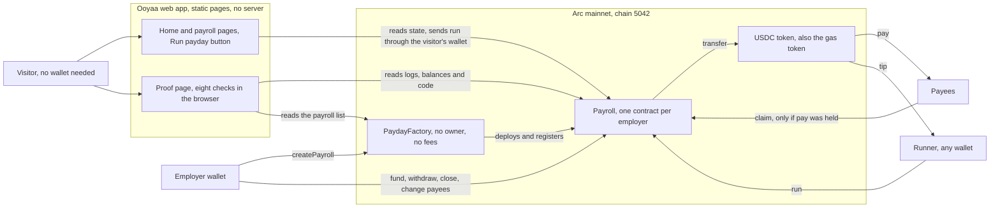
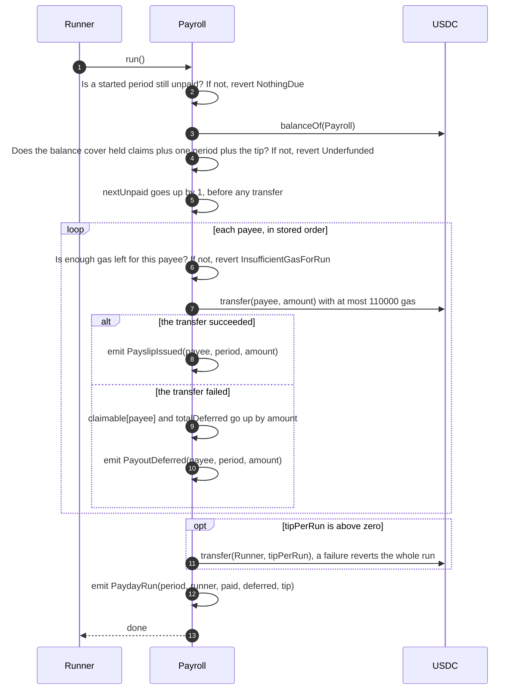
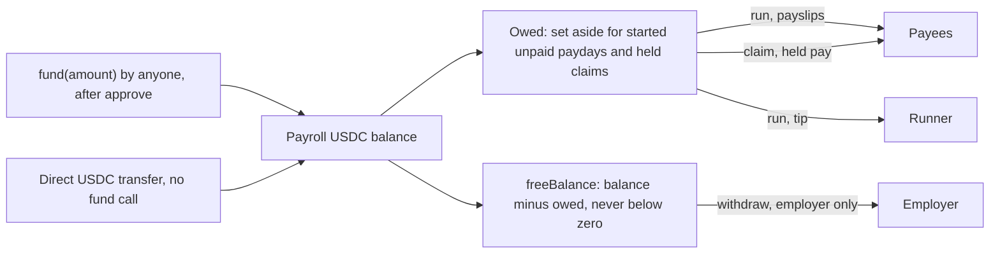

# Ooyaa

Payday that never misses: contractors paid in USDC on a fixed day, exactly once, and anyone can press the button.

Ooyaa is Tamil for never resting, unceasing: the name for a payday with no server that can stop or run dry.

Payday runs without the employer being online. Anyone can press Run payday and earn a small USDC tip, each payee is paid exactly once per period in order, and a proof page re-checks every cent live from the chain.

It already works that way. Within a day of going live, a wallet we do not control ran the demo payroll 37 times to collect the tip, paying 111 payslips while nobody on our side pressed anything. The [proof page]({{LIVE_APP_URL}}/proof) lists every runner, ours and outside.

[Live app]({{LIVE_APP_URL}}) | [Docs]({{LIVE_APP_URL}}/docs) | [Proof]({{LIVE_APP_URL}}/proof) | [Arc Studio project](https://studio.arc.io/app/dd654bc5-3b39-44da-bd26-b241e830343f)

## Live Deployments

Arc mainnet, chain id 5042, explorer [explorer.arc.io](https://explorer.arc.io).

| What | Address or transaction |
|---|---|
| PaydayFactory | [`0x18C7c54b0E521B7a34D79608ac8CfA91466eDc9b`](https://explorer.arc.io/address/0x18C7c54b0E521B7a34D79608ac8CfA91466eDc9b), deployed in block 28261674 |
| Demo payroll: 3 payees, 0.01 USDC each, hourly, 0.01 USDC tip | [`0xf03714EA422237BCb5d1B0BDd40B4Ff22B13717A`](https://explorer.arc.io/address/0xf03714EA422237BCb5d1B0BDd40B4Ff22B13717A), created in block 28272851 |
| USDC | [`0x3600000000000000000000000000000000000000`](https://explorer.arc.io/address/0x3600000000000000000000000000000000000000) |
| Factory deploy transaction | [`0x8ddfb41d4d6832025de23bf958cdeb27bc270e7f6636110cf7cf807efa91d26e`](https://explorer.arc.io/tx/0x8ddfb41d4d6832025de23bf958cdeb27bc270e7f6636110cf7cf807efa91d26e) |
| Demo payroll creation | [`0xff12ca1562da948689d1e7e9de970a43ae9e038e9f0f24fd1afe9c844184af34`](https://explorer.arc.io/tx/0xff12ca1562da948689d1e7e9de970a43ae9e038e9f0f24fd1afe9c844184af34) |
| First payday: three payslips and a tip, 185,555 gas | [`0x0692c42dd090bf022e41b9bb57d130ec6c1402615e0abb10d6ba9f1674c07fec`](https://explorer.arc.io/tx/0x0692c42dd090bf022e41b9bb57d130ec6c1402615e0abb10d6ba9f1674c07fec) |

The source of the factory and the demo payroll is verified on Sourcify with an exact match.

## Overview

An employer lists the people to pay and how much each gets, picks a pay period, and funds a payroll with USDC. When a period starts, any wallet can call `run()`. The contract pays every payee, records a payslip for each one on the chain, and sends a tip to the wallet that pressed the button. A counter makes sure each period is paid once and in order. If one payee cannot receive USDC, their share is held for them to claim and everyone else is still paid.

There is no server to keep alive and no admin key. The contracts are immutable. The web app is a set of static pages that read Arc directly, and a proof page re-runs eight checks against the chain in your browser.

| | Payroll today | Ooyaa |
|---|---|---|
| Who starts payday | The employer, or a service the employer pays and trusts | Anyone. The first wallet to press the button earns the tip. |
| If the employer is offline | Payday waits | A funded payday still runs |
| Paying a period twice or skipping one | Caught by a person, after the fact | Refused by the contract |
| One payee's account is blocked | Often holds up the batch | That share is held for them to claim, everyone else is paid |
| Wages already earned | Depends on the provider's rules | The employer cannot withdraw money owed for a started period |
| Proof that a payment happened | A statement from the provider | A transaction on Arc and a payslip event anyone can read |
| An off switch | Held by the provider | None. The employer can close a payroll, and started paydays still run. |

## Features

### For employers

- Create a payroll in one transaction: 1 to 100 payees, a pay period from 60 seconds to 366 days, a first payday up to a year ahead, and a tip from 0 to 10 USDC.
- Anyone can add USDC, at any time. The employer can withdraw only what is not already owed.
- Add, change or remove payees between paydays. Close the payroll when you are done. Hand the role to another address in two steps.
- Live numbers on chain: balance, owed, free balance and how many paydays the money covers.

### For payees

- Pay arrives straight in your wallet. You sign nothing to be paid.
- Every payday leaves a `PayslipIssued` event with the period, the amount and the transaction.
- If your transfer fails, the amount is held for you and only you can claim it.

### For runners

- Press Run payday on any due payroll and earn the tip.
- The app asks the contract first. If the payday is already paid, you see why and nothing is sent to your wallet.
- Missed paydays are paid one per transaction, oldest first.

### For anyone checking the work

- A proof page that re-runs eight checks from the chain: same code as the repository, same code as testnet, verified source, made by the factory, paid once in order, every payslip a real transfer, every cent accounted for, a second run refused.
- The same checks from a terminal with `bun run prove`.
- A CSV download of every USDC movement.

## Testnet

The same contracts are on Arc testnet. They have the same bytecode as mainnet, which is what check C2 proves.

| What | Address |
|---|---|
| Network | Arc testnet, chain id 5042002, [explorer.testnet.arc.io](https://explorer.testnet.arc.io) |
| PaydayFactory | [`0xb32feb10b48d753dee8938435ebe1c303ce6955b`](https://explorer.testnet.arc.io/address/0xb32feb10b48d753dee8938435ebe1c303ce6955b) |
| Reference payroll | [`0x1b31ea6ce9c6ad70444c476166eb219026e6c1d3`](https://explorer.testnet.arc.io/address/0x1b31ea6ce9c6ad70444c476166eb219026e6c1d3) |
| USDC | `0x3600000000000000000000000000000000000000`, the same address as on mainnet |

## Architecture

The full write-up, with the list of contract calls the app makes, is in [ARCHITECTURE.md](ARCHITECTURE.md).

How the pieces connect:



What happens inside one payday:



Where the money goes:



## The two-minute judge path

1. Open the [live app]({{LIVE_APP_URL}}). The demo payroll is on the first screen, with a countdown, its payees and how many paydays it is funded for. No wallet is needed to look.
2. Press Connect and pick a browser wallet on Arc mainnet with a few cents of USDC for gas. Press Run payday and sign once. Three payslips are stamped PAID and the 0.01 USDC tip arrives in your wallet.
3. Press the button again. If no other payday is waiting, the contract refuses before your wallet is asked to sign: "this payday is already paid".
4. Open the [proof page]({{LIVE_APP_URL}}/proof). Eight checks run against Arc and the sheet is stamped VERIFIED. Your wallet appears in the list of runners, marked OUTSIDE.
5. Click any transaction in the ledger to open it on explorer.arc.io.
6. Optional: read [Create a payroll]({{LIVE_APP_URL}}/docs/create-payroll) and make one of your own with a 2-minute period.

Then check it from a terminal. You need [Bun](https://bun.sh) and [Foundry](https://getfoundry.sh).

```bash
git clone https://github.com/ramakrishnanhulk20/ooyaa ooyaa
cd ooyaa
bun install
forge build
bun run prove --payroll 0xf03714EA422237BCb5d1B0BDd40B4Ff22B13717A
```

The last line of the output is:

```text
RESULT: 8 passed, 0 failed, 0 skipped
```

Without `--payroll`, the command checks every payroll the factory has made. Checks C1 to C3 run once and C4 to C8 run once per payroll, so more payrolls mean more lines. A skipped check counts as skipped, not passed: C1 is skipped if you have not run `forge build`. The options and exit codes are in [Prove-it CLI]({{LIVE_APP_URL}}/docs/prove-it).

## Quick Start

You need [Bun](https://bun.sh) and [Foundry](https://getfoundry.sh). No environment variables are required.

```bash
git clone https://github.com/ramakrishnanhulk20/ooyaa ooyaa
cd ooyaa
bun install
bun run dev                                  # the app, at http://localhost:5173
bun run prove                                # re-check Arc mainnet from the chain
forge test --no-match-contract PayrollFork   # unit, fuzz and invariant tests
```

The app reads Arc mainnet from public RPC nodes, so it works from a local server with no keys. Run `forge build` before `bun run prove` so check C1 can compare mainnet with your own build.

The fork tests run against real USDC state, with Arc's Foundry build and a fork URL. Standard Foundry cannot simulate USDC as Arc's native token, so these 6 tests fail there by design. Install Arc's Foundry build from [github.com/circlefin/arc-foundry](https://github.com/circlefin/arc-foundry), as its README describes; it installs as `arc-forge`.

```bash
arc-forge test --match-path contracts/test/PayrollFork.t.sol --fork-url https://rpc.testnet.arc.io
```

We ran them with Arc's Foundry build against both Arc testnet and Arc mainnet state.

## Contract functions

Full signatures, reverts, events and errors are in [Contracts]({{LIVE_APP_URL}}/docs/contracts).

| Contract | Function | Who | What it does |
|---|---|---|---|
| PaydayFactory | `createPayroll(payees, amounts, startTime, periodLength, tipPerRun)` | Anyone | Deploys a payroll with the caller as employer |
| PaydayFactory | `isPayroll(address)` | Anyone | True only for payrolls this factory made |
| PaydayFactory | `payrollCount()`, `payrollAt(i)`, `allPayrolls(offset, limit)` | Anyone | The public list of payrolls |
| PaydayFactory | `createdBy(employer)`, `payrollsCreatedBy(employer, offset, limit)` | Anyone | Payrolls an address created |
| Payroll | `run()` | Anyone | Pays the next unpaid period and sends the tip to the caller |
| Payroll | `fund(amount)` | Anyone | Adds USDC from the caller, after an approve |
| Payroll | `claim()` | A payee with held pay | Sends the caller their held pay |
| Payroll | `withdraw(amount)` | Employer | Takes out free balance, never money that is owed |
| Payroll | `addPayee`, `updatePayee`, `removePayee` | Employer | Change the schedule when every started period is paid |
| Payroll | `close()` | Employer | Stops future periods for good |
| Payroll | `transferEmployer`, `cancelEmployerTransfer`, `acceptEmployer` | Employer, then the new employer | Two-step handover |
| Payroll | `owed`, `freeBalance`, `runway`, `dueNow`, `startedPeriods`, `nextPayday`, `periodStart`, `getPayees`, `getState` and the public getters | Anyone | Read the payroll |

## Tests

Results from the last full runs, on 31 October 2026:

| Suite | Command | Result |
|---|---|---|
| Unit, fuzz and invariant tests | `forge test --no-match-contract PayrollFork` | 89 passed, 0 failed in Arc Studio. Foundry 1.8.6 groups the invariant campaign and reports the same suite as 77 passed, 0 failed. |
| Real-USDC fork tests | `arc-forge test --match-path contracts/test/PayrollFork.t.sol --fork-url https://rpc.testnet.arc.io` | 6 passed, 0 failed, on Arc testnet and on Arc mainnet state. They need Arc's Foundry build. |
| App tests | `bun test src` | 228 passed, 0 failed |

`bun run facts` writes the Studio counts to `src/generated/build-facts.json`, and the proof page shows them.

## Gas in plain English

A payday is one transaction, and the runner pays for it in USDC.

- A run for 3 payees used 185,555 gas on mainnet. At the price that day that was 0.003896655 USDC, about 0.004 USDC. The tip on the demo is 0.01 USDC.
- A run for 100 payees takes about 5 million gas in our fork tests, about 0.1 USDC at the same price.
- Each payee's transfer gets at most 110,000 gas. A run of 100 payees that all burn their whole budget would use about 14 million gas, under Arc's per-transaction cap of 16,777,216.
- Creating the demo payroll used 2,057,305 gas. Funding it used 52,130.

Gas prices change, so treat these as examples.

## Project structure

```text
contracts/
  Payroll.sol            one payroll per employer
  PaydayFactory.sol      ownerless factory and registry
  test/                  unit, fuzz, invariant and fork tests
  test-helpers/          token mocks used by the tests
src/
  pages/                 home, payroll, proof and docs pages
  components/            payroll card, payslip, proof sheet, ledger
  payroll/               the run flow, state, formatting and their tests
  proof/                 the eight checks, log reading, ABI and their tests
  deployments.ts         addresses and deploy blocks
  generated/             bytecode and test counts written by scripts
scripts/
  prove-it.ts            the command behind bun run prove
  gen-abi.ts, gen-runtime.ts, gen-build-facts.ts
content/docs/            the pages shown at /docs
docs/security/           the threat model
prompts/                 the Arc Studio prompts, in order
ARCHITECTURE.md
```

## Tech stack

| Layer | Tools |
|---|---|
| Contracts | Solidity 0.8.28, Foundry, OpenZeppelin 5.6.1 |
| App | React 18, Vite, TypeScript, Tailwind CSS, wagmi 2, viem 2, ConnectKit, TanStack Query |
| Proof tooling | TypeScript, viem, Bun, Sourcify |
| Docs | Markdown pages in the app, Mermaid diagrams |
| Chain | Arc mainnet (5042) and Arc testnet (5042002) |
| Token | USDC at `0x3600000000000000000000000000000000000000`, 6 decimals |
| Built with | Arc Studio |

## Security

Ooyaa has not been audited. Use small amounts. The contracts have no admin, no pause and no upgrade path, and they move USDC only to fixed destinations. Salaries and payee addresses are public on chain.

The threat model, with every rule and review round, is in [docs/security/threat-model.md](docs/security/threat-model.md). A plain-English summary and the list of what was and was not tested are in [Limits]({{LIVE_APP_URL}}/docs/limits).

## Licence

MIT. Each contract carries an `SPDX-License-Identifier: MIT` header.

## Acknowledgments

Built on [Arc](https://docs.arc.io) and Circle's USDC, and built with [Arc Studio](https://studio.arc.io), which wrote and tested the contracts and the app from our prompts. Thanks also to OpenZeppelin, Foundry, viem, wagmi and Sourcify.
