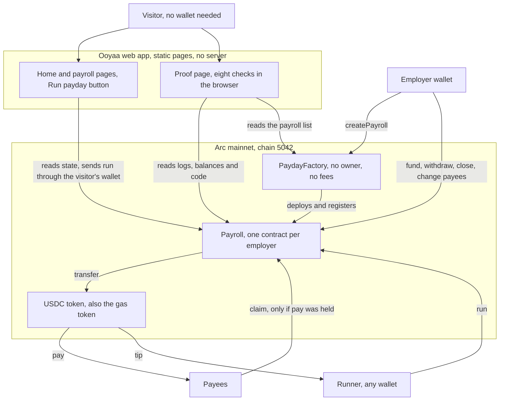
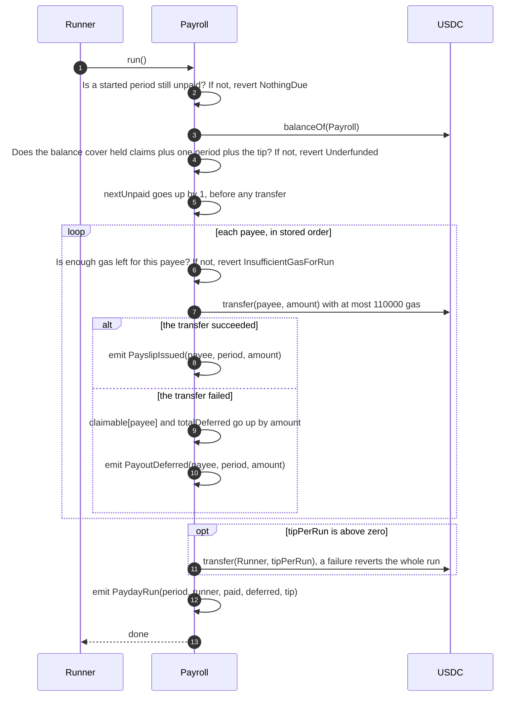
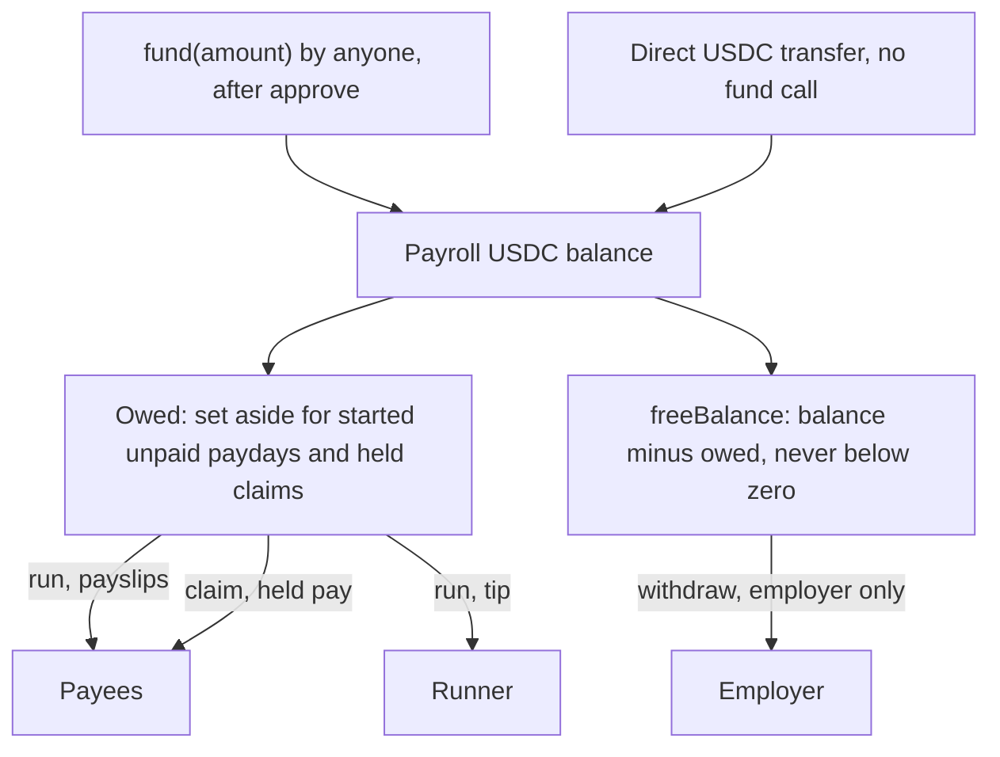

Ooyaa is two smart contracts and a static web app. There is no server, no database and no admin key. This page shows how the pieces fit, what happens inside a payday, where the money goes, and what is deployed. The same material, with the full list of contract calls the app makes, is in [ARCHITECTURE.md](https://github.com/ramakrishnanhulk20/ooyaa/blob/main/ARCHITECTURE.md) in the repository.

## System overview

The employer creates a payroll through the factory. The factory deploys one Payroll contract per employer and keeps a public list of them, so any address can be checked as "made by the factory" in a single call. The employer funds the payroll with USDC. When a payday is due, any wallet can call `run()`. The Payroll pays every payee straight from its own balance and sends a small tip to the wallet that pressed the button.

The web app is a set of static pages. The home page and the payroll pages read the contract and offer a Run payday button. The proof page reads logs, balances and bytecode from Arc and re-checks them in your browser.



## The payday: what `run()` does

`run()` pays one period. It checks that a started period is waiting and that the balance covers it, and it moves the period counter forward before any money moves. Then it pays each payee in the stored order with a capped amount of gas, so one payee that cannot receive USDC cannot stop the others.

If a payee's transfer fails, that payee's amount is not lost and not paid to anyone else. It is recorded as a claim that only that payee can collect later. The runner's tip is sent last. If the tip transfer itself fails, the whole transaction reverts and nothing changes.



Three details worth knowing:

- Paydays go in order. `run()` takes no argument. It always pays the period at `nextUnpaid`. If three paydays were missed, three calls pay them one after another.
- The gas cap per payee is 110,000. The runner must send enough gas for the cap plus a reserve, about 161,746 gas left before each payee. If the runner sends too little, the run reverts with `InsufficientGasForRun`. A low gas limit can never cause a payee to be deferred.
- A second call for the same period reverts with `NothingDue`. That is the "exactly once" rule, and the proof page checks it on the real contract.

## Where the money goes

USDC enters a payroll through `fund(amount)`, which anyone can call after approving the payroll to pull the USDC. A plain USDC transfer to the payroll's address also works and shows up as a "direct deposit" on the proof page.

USDC leaves in four ways only. Payslips and tips leave during `run()`. A payee collects held pay with `claim()`. The employer takes out the free balance with `withdraw()`. Every one of these sends to a fixed destination: the payee, the runner, the claimant or the employer. No function lets a caller name a different recipient.



The two quantities are defined once in the contract and every function uses the same definition:

```text
owed        = (startedPeriods - nextUnpaid) * (periodTotal + tipPerRun) + totalDeferred
freeBalance = balance - owed        (0 when balance is not above owed)
runway      = freeBalance / (periodTotal + tipPerRun)    (0 after close)
```

`startedPeriods` counts the periods whose start time has passed. After `close()` it stops growing. `totalDeferred` is the sum of all held claims. The employer can withdraw `freeBalance` and nothing more, so money owed for a started period can never be taken back.

## Deployed addresses

| Network | Contract | Address | Where to look |
|---|---|---|---|
| Arc mainnet (5042) | PaydayFactory | `0x18C7c54b0E521B7a34D79608ac8CfA91466eDc9b` | [explorer](https://explorer.arc.io/address/0x18C7c54b0E521B7a34D79608ac8CfA91466eDc9b), deployed in block 28261674, [tx 0x8ddfb41d...1d26e](https://explorer.arc.io/tx/0x8ddfb41d4d6832025de23bf958cdeb27bc270e7f6636110cf7cf807efa91d26e) |
| Arc mainnet (5042) | Demo payroll | `0xf03714EA422237BCb5d1B0BDd40B4Ff22B13717A` | [explorer](https://explorer.arc.io/address/0xf03714EA422237BCb5d1B0BDd40B4Ff22B13717A), created in block 28272851, [tx 0xff12ca15...4af34](https://explorer.arc.io/tx/0xff12ca1562da948689d1e7e9de970a43ae9e038e9f0f24fd1afe9c844184af34) |
| Arc mainnet (5042) | USDC | `0x3600000000000000000000000000000000000000` | [explorer](https://explorer.arc.io/address/0x3600000000000000000000000000000000000000) |
| Arc testnet (5042002) | PaydayFactory | `0xb32feb10b48d753dee8938435ebe1c303ce6955b` | [explorer](https://explorer.testnet.arc.io/address/0xb32feb10b48d753dee8938435ebe1c303ce6955b) |
| Arc testnet (5042002) | Reference payroll | `0x1b31ea6ce9c6ad70444c476166eb219026e6c1d3` | [explorer](https://explorer.testnet.arc.io/address/0x1b31ea6ce9c6ad70444c476166eb219026e6c1d3) |

The demo payroll has 3 payees at 0.01 USDC each, a payday every hour and a 0.01 USDC tip. The first mainnet payday on it is [tx 0x0692c42d...c07fec](https://explorer.arc.io/tx/0x0692c42dd090bf022e41b9bb57d130ec6c1402615e0abb10d6ba9f1674c07fec), block 28281381, which used 185,555 gas.

Neither contract uses immutable variables, the factory takes no constructor arguments, and USDC is a compile-time constant. So the contract code on mainnet is byte for byte the code on testnet, and any payroll's code equals any other payroll's code. The proof page and `bun run prove` compare them exactly. The source is verified on Sourcify with an exact match for all four contracts.

## Reads and writes the app makes

The app reads Arc mainnet only. Its one write on the payroll card is `Payroll.run()`, simulated first and sent through the visitor's own wallet. The create and employer screens add `createPayroll`, `approve`, `fund`, `withdraw`, `close` and `claim`, each also simulated first. No write takes an address or an amount from the URL. The table of every read and write, with where it is used, is in [ARCHITECTURE.md](https://github.com/ramakrishnanhulk20/ooyaa/blob/main/ARCHITECTURE.md#what-the-app-reads-and-writes).
